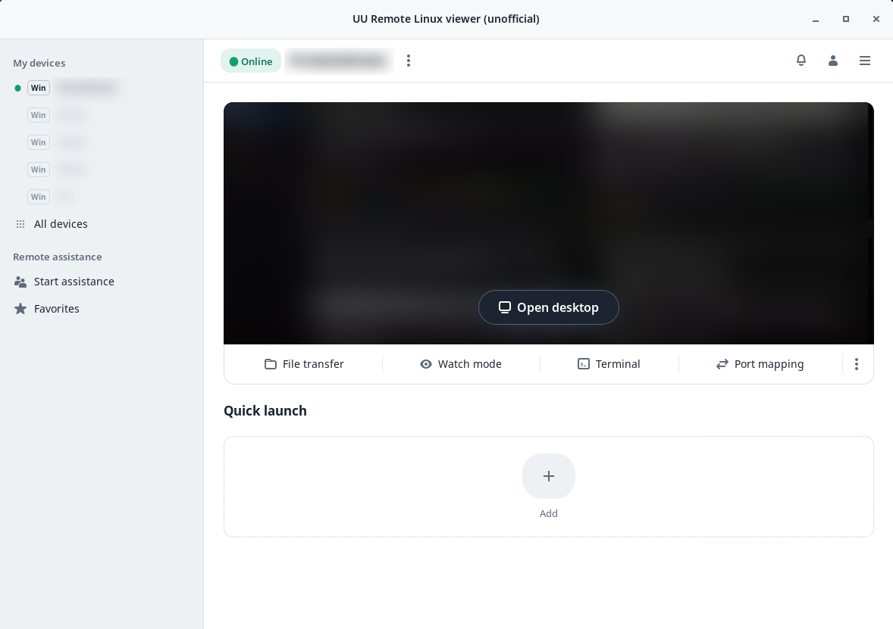

# uu-remote-linux · 网易 UU 远程 Linux 版（非官方）

**简体中文** | [English](README.en.md)

在 Linux 上使用**网易 UU 远程**，双向都可以：

- **被控端**（`uuremote-server`）：用 UU 账号登录后，本机出现在官方 Windows / Mac / 手机客户端的设备列表中，可直接远控：
  桌面、声音、文件传输、终端、端口映射、远程协助。
- **控制端**（`uuremote-viewer`）：在 Linux 上远控你的 Windows / Mac / Linux 设备，带设备列表、窗口内控制中心和网络状态面板。

Rust + C 原生实现，不需要 Wine，不包含网易的程序。界面支持**中文和英文**。

<p align="center"></p>

> 个人兴趣项目，**与网易无关**，不是官方客户端。
> 联系方式：X（推特）**[@spaleon_x](https://x.com/spaleon_x)**。

## 本分支新增

| | |
|---|---|
| 🌐 **中英文界面** | 所有窗口与提示均支持两种语言，可在设置中切换 |
| 🔎 **清晰的画面** | 按被控端原始分辨率解码并平滑缩放，文字不再发虚、粗细不均 |
| ⏳ **加载画面** | 连接时显示流畅的加载动画和当前阶段，不再是黑屏 |
| 🎛 **控制中心** | 与官方客户端菜单一致：画质（自动 / 原画 20M / 超清 8M / 高清 2M）、30–144 帧、真彩 4:4:4、跟随被控端或窗口分辨率、自适应 / 实际大小 1:1、音量、远程结束后自动锁屏、被控端静音、发送系统快捷键（Alt+Tab）、文件传输、观看模式、全屏、退出远控 |
| 📶 **网络状态** | 连接时长、UDP/TCP 直连或中转、帧率与编码、码率、延迟、丢包、分辨率；`Ctrl+Alt+G` 显示 / 隐藏（会记住） |
| 🖼 **设备预览图** | 设备卡片显示该电脑最近的画面，与官方客户端一样（仅保存在本机） |
| 🔗 **登录即可被控** | 在控制端登录后，本机自动加入账号的设备列表，你的所有 UU 客户端都能远控它 |

## 安装

**发布包**（x86_64 / aarch64）：在 [Releases](https://github.com/spixyy7/uu-remote-linux/releases/latest) 下载。

```sh
# Ubuntu / Debian
sudo apt install ./uu-remote-linux_<版本>_amd64.deb

# 其他发行版（安装到 ~/.local）
tar xzf uu-remote-linux-<版本>-x86_64-linux.tar.gz
cd uu-remote-linux-<版本>-x86_64-linux && ./install.sh
```

然后启动控制端，用 UU 远程手机 App 扫码登录：

```sh
uuremote-viewer ui
```

登录后被控端服务（`uuremote-native.service`）会自动启动，本机随即出现在你的其他 UU 客户端中。
只使用被控端：`uuremote-server login`，再执行 `systemctl --user enable --now uuremote-native.service`。

需要 FFmpeg（安装脚本会检查）。源码编译、桌面支持（X11、GNOME/KDE Wayland、Hyprland/Sway）、无显示器服务器和
Docker / NAS 部署见[技术参考](docs/reference.zh.md)。

## 控制端快捷键

| 按键 | 功能 |
|---|---|
| `Ctrl+Alt+M` 或顶部的「控制中心」按钮 | 打开 / 关闭控制中心 |
| `Ctrl+Alt+G` | 显示 / 隐藏网络状态 |
| `Ctrl+Alt+Enter` | 全屏 |
| `Ctrl+Alt+F` | 文件传输 |

## 语言

顺序：`UU_LANG=zh|en` → **设置 → 常规 → 语言 / Language**（控制端或主机窗口；保存在 `~/.config/uuremote/language`，重启后生效）
→ 系统区域设置（`zh*` 为中文，其余为英文）。

## 常用设置

| 变量 | 作用 |
|---|---|
| `UU_VIEWER_CHROMA=444` | 一开始就请求真彩（文字最清晰） |
| `UU_VIEWER_SIZE=WxH` | 解码到固定画布，而不是原始分辨率 |
| `UU_VIEWER_THUMBNAILS=0` | 不保存设备预览图 |
| `UU_VIEWER_HOST=0` | 控制端登录后不自动启动被控端服务 |
| `UU_VIEWER_UI_SCALE=1.5` | 放大窗口内控件（高分屏） |
| `UU_VIEWER_FONT=/path/font.ttf` | 窗口内控件使用的字体（默认：fontconfig 的 sans-serif） |

被控端的全部选项见[技术参考](docs/reference.zh.md)。

## 尚未实现

HDR、超级屏 / 虚拟显示器、被控端防窥模式、麦克风（控制端声音在被控端播放）、插件，以及无人登录时的 Linux 登录界面。
详见[技术参考](docs/reference.zh.md)。

## 隐私

日志只记录大小、数量和字段编号，绝不记录按键、剪贴板、文件、密码或令牌。
登录信息保存在 `~/.config/uuremote/config.json`（0600），设备预览图保存在 `~/.cache/uuremote/thumbs`（0600）。

## 许可与致谢

GPL-3.0，见 [LICENSE](LICENSE)。基于 [VallierDev/uu-remote-linux](https://github.com/VallierDev/uu-remote-linux)。
「网易」「UU 远程」为其权利人的商标；本项目不包含网易的代码或素材。权利人如有异议，请联系 [@spaleon_x](https://x.com/spaleon_x)。
